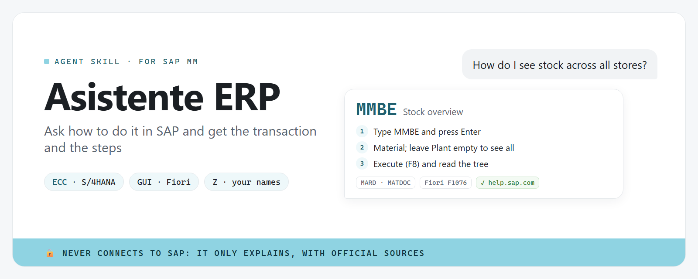

[Español](README.md) · **English**



<p align="center"><strong>Ask your AI assistant how to do something in SAP, in plain language, and get the transaction code, the steps and the tables, adapted to your SAP version and your company's own names.</strong></p>

## What is this?

**Asistente ERP** is a "skill" (a knowledge pack) for SAP MM that you install in your AI assistant. You ask, for example,
*"how do I see stock across all stores?"*, and it answers with:

- **the transaction code** (like `MMBE`), which you type in SAP to jump straight to the screen;
- **the steps**, one by one, in plain words;
- **the key fields and tables**, in case you need them;
- **the differences** between SAP ECC and SAP S/4HANA, and the matching Fiori app.

Version 1 covers **MM (Materials Management): inventory and purchasing**. Answers are in
Spanish by default, or in your language.

## Who is it for?

Anyone who uses SAP at work and doesn't remember (or never learned) how to do something:
warehouse, purchasing, planning and admin staff, or people new to the company. No coding needed.

> [!IMPORTANT]
> **It never connects to SAP.** It only explains. It doesn't log in, doesn't see your data and never asks for your password.
> **Everything comes from official documentation.** Each answer comes from an entry checked against [help.sap.com](https://help.sap.com), with its link. Anything that couldn't be confirmed is marked "sin verificar" (not verified).
> **Your company may configure SAP differently.** If something doesn't match, ask your company's SAP key user.

## How to use it (the easy way)

1. **Ask your AI assistant to install it.** If you use Claude Code or another AI agent
   (an assistant that can work with files on your computer), paste this message:

   ```text
   Install the asistente-erp skill from https://github.com/alejandrocimentada/asistente-erp
   ```

   <details>
   <summary><b>Don't have an AI agent? Here's how to start (5 minutes)</b></summary>

   1. **What an AI agent is:** an assistant, like Claude Code, that can work with files on
      your computer: read them, run programs and explain the results.
   2. **Open the terminal** (the window where you type commands):
      - Windows: press the Windows key, type "PowerShell" and open it.
      - Mac: press Cmd + Space, type "Terminal" and open it.
   3. **Install Claude Code** by following the
      [official quickstart](https://code.claude.com/docs/en/quickstart) (steps 1 and 2).
      You'll need a Claude account; the guide explains which plans include Claude Code.
   4. **Type `claude`** and press Enter to open the agent. The first time it asks you to sign
      in with your Claude account. Then paste the message from step 1.

   </details>

2. **Answer 4 questions the first time.** The assistant will ask:
   - **Your SAP version.** To check it: in SAP GUI, menu **System → Status**. It shows whether
     it's ECC (e.g. "EHP8") or S/4HANA (e.g. "S/4HANA 2023"). If you don't know, say so and move on.
   - **Whether you use SAP GUI** (the classic screen with a field to type transactions) **or Fiori** (the tiles in the browser).
   - **The language of your SAP screens.**
   - **Whether your company has its own transactions** (the ones starting with Z, like `ZMM_STOCK`).

   Your answers are saved on your computer, in `~/.config/asistente-erp/profile.yaml`.

3. **Ask whatever you need**, like you'd ask a coworker:

   > How do I create a purchase order?
   > How do I know when what we ordered will arrive?
   > How do I move stock from one storage location to another?
   > How do I export this report to Excel?

## Teach it your company's names

Many companies have their own transactions or names. Just tell the assistant:

> Here we call it "quick check", it's transaction ZMM_STOCK.

The assistant saves it and next time answers with **your** transaction first, then the
standard SAP one.

## Example answer

> **Question:** How do I see stock across all stores?
>
> **`MMBE`**: shows how much of a material there is in each plant (store), storage location and batch.
> 1. Type `MMBE` in the command field and press Enter.
> 2. Enter the material number. Leave Plant and Storage Location empty to see all of them.
> 3. Press Execute (F8) and read the tree: the *Unrestricted use* column is what's available.
>
> In S/4HANA you can also use the Fiori app *Stock - Single Material* (F1076).
> If some plants are missing, it may be a permissions issue: ask your key user.
> Source: help.sap.com

## What does version 1 cover?

| Task | Transaction |
|---|---|
| Stock of one material across all plants and storage locations | `MMBE` |
| Stock list of a plant or storage location (many materials) | `MB52` |
| Goods movements of a material | `MB51` |
| Stock, requirements and incoming receipts | `MD04` |
| Display / change material master | `MM03` / `MM02` |
| Minimum stock, reorder point and safety stock | `MM02` (MRP views) |
| Create / change / display a purchase order | `ME21N` / `ME22N` / `ME23N` |
| Purchase orders by vendor / by material | `ME2L` / `ME2M` |
| Create / display a purchase requisition | `ME51N` / `ME53N` |
| Goods receipt for a purchase order | `MIGO` |
| Transfer stock between storage locations or plants | `MIGO` |
| Stock transport order between plants | `ME21N` + `MIGO` |
| Export a report to Excel | (any report) |

## Glossary

- **Transaction (transaction code)**: the "shortcut" you type in SAP to open a screen, like `MMBE` or `ME21N`.
- **Plant**: a factory, store or branch. The main unit where stock is kept.
- **Storage location**: a place inside the plant where goods are stored.
- **Purchase order**: the document used to buy from a supplier. Spanish SAP calls it "pedido".
- **Purchase requisition**: the internal request to Purchasing that something is needed. Purchasing turns it into a purchase order.
- **Movement type**: 3-digit code for the kind of stock movement (e.g. 101 = goods receipt for a purchase order).
- **ECC and S/4HANA**: ECC is the previous SAP release; S/4HANA is the new one. Most transactions stay the same, but some things change under the hood.
- **SAP GUI and Fiori**: SAP GUI is the classic program; Fiori is the web interface with tiles (apps).
- **Z transactions**: transactions built by your company. They start with Z or Y and only exist in your system.
- **Key user**: the person at your company who knows how SAP is set up in your area.

## FAQ

**Can it see my SAP data or do things in SAP for me?**
No. It doesn't connect to SAP. It explains what to do; you do it in your SAP.

**What if my screen looks different?**
That's normal: every company configures SAP its own way, and labels change with language and
release. The transaction code is the most reliable part. If something doesn't match, ask your key user.

**What if I ask something that isn't covered?**
The assistant will tell you it isn't in its knowledge base instead of making something up.
For now it covers MM (inventory and purchasing); sales, finance and production are not covered yet.

**Where is what I tell it about my company stored?**
In a file on your own computer (`~/.config/asistente-erp/profile.yaml`), outside the skill
folder. It isn't sent anywhere.

**Do I need to know how to code?**
No, if you use an AI agent like Claude Code. The agent takes care of everything.

---

## For technical users

**asistente-erp** is an agent skill for SAP MM (Claude Code, Codex and other agents that support
`SKILL.md`). It's knowledge only: [`SKILL.md`](SKILL.md) + YAML entries in
[`knowledge/mm/`](knowledge/mm/) + two small Python scripts. The agent looks up the answer with
`scripts/erp_lookup.py` and answers from the entry, not from memory.

### Manual install

Requirements: Python 3.10 or later and `pip`.

**Claude Code (macOS / Linux)**

```bash
git clone https://github.com/alejandrocimentada/asistente-erp.git
mkdir -p ~/.claude/skills/asistente-erp
cp -R asistente-erp/. ~/.claude/skills/asistente-erp/
pip install -r ~/.claude/skills/asistente-erp/requirements.txt
```

**Claude Code (Windows PowerShell)**

```powershell
git clone https://github.com/alejandrocimentada/asistente-erp.git
New-Item -ItemType Directory -Force "$HOME\.claude\skills\asistente-erp" | Out-Null
Copy-Item -Recurse -Force "asistente-erp\*" "$HOME\.claude\skills\asistente-erp\"
pip install -r "$HOME\.claude\skills\asistente-erp\requirements.txt"
```

**Codex**

```bash
git clone https://github.com/alejandrocimentada/asistente-erp.git
mkdir -p ~/.codex/skills/asistente-erp
cp -R asistente-erp/. ~/.codex/skills/asistente-erp/
pip install -r ~/.codex/skills/asistente-erp/requirements.txt
```

### Command-line use (no agent)

```bash
python scripts/erp_lookup.py "ver stock en todas las tiendas"   # Spanish or English
python scripts/erp_lookup.py "create purchase order" --top 1
python scripts/erp_lookup.py --id goods-receipt-po              # one full entry
python scripts/erp_lookup.py --list                             # all entries
python scripts/erp_lookup.py "MIGO" --json                      # JSON output
```

When nothing matches it prints `SIN RESULTADOS` and exits with code 1 (the agent must not
guess). Questions that clearly belong to other areas (sales, finance, payroll, production) are rejected.

```bash
python scripts/erp_profile.py show
python scripts/erp_profile.py set sap_product s4hana             # ecc | s4hana | s4hana_cloud | unknown
python scripts/erp_profile.py set ui fiori                       # gui | fiori | both
python scripts/erp_profile.py add-name --term "quick check" --tcode ZMM_STOCK --entry stock-overview
python scripts/erp_profile.py remove-name --term "quick check"
```

The profile lives in `~/.config/asistente-erp/profile.yaml` (or the path in
`ASISTENTE_ERP_PROFILE`). The script refuses to save it inside the skill folder.

### Entry format

One entry per task in `knowledge/mm/<id>.yaml`:

| Field | Content |
|---|---|
| `id`, `names.es`, `names.en` | identifier and task name in Spanish and English |
| `tcode`, `related_tcodes` | main and related transactions |
| `keywords.es`, `keywords.en` | how people phrase the question (for search) |
| `summary` | what it does, in one or two sentences |
| `s4hana_notes` | ECC vs S/4HANA differences |
| `fiori_app` | Fiori app name and ID (or `null` if none is verified) |
| `steps` | steps in plain Spanish |
| `key_fields` | key fields, with the technical name when verified |
| `tables` | main tables (MARA, MARC, MARD, EKKO, EKPO, MSEG/MATDOC…) |
| `common_errors` | common errors, what they mean and what to do; `verified: true/false` |
| `verification` | `status` (`verificado` / `parcial`) and the `sin_verificar` list |
| `sources`, `last_verified` | help.sap.com links and date of last review |

### How verified is it?

Reviewed on **2026-10-08** against SAP's official documentation on
[help.sap.com](https://help.sap.com) (SAP Help Portal and SAP Support Content), citing 59
distinct pages. The text is original: it explains in other words and doesn't copy the documentation.

- **18 entries.** **15 "verificado"**: the transaction, ECC / S/4HANA differences, Fiori app and
  tables are all backed by a source. 13 of those 15 also note a minor detail in `sin_verificar`
  (e.g. the exact label of a checkbox, or a technical field name). **3 "parcial"**:
  - `ME2L` and `ME2M`: only ECC documentation was found; that they still exist in S/4HANA is
    not confirmed (the Fiori app *Monitor Purchase Order Items*, F2358, is offered and is confirmed).
  - Stock transport order: no dedicated Fiori app was found, and the delivery-based flow
    (`VL10B` / `VL02N`) depends on each company's configuration.
- **Common errors:** 11 of 39 are backed by a source (e.g. `M7021`, `ME083`); the rest are typical
  situations, flagged `verified: false`.
- **Steps** describe standard SAP. Spanish screen labels couldn't be confirmed one by one,
  so each step also gives the English label in parentheses.
- **Links are checked** with `python scripts/check_sources.py` (59 of 59 working on 2026-10-08).

### Development and validation

```bash
pip install -r requirements.txt pytest
python -m pytest                       # 152 tests
python scripts/check_sources.py        # checks the links (needs internet)
```

The tests check that every entry has all fields and at least one help.sap.com source; that
search finds the right entry for 32 typical questions in Spanish and English (and nothing for
out-of-scope questions); and that the profile saves and loads correctly without ever writing
inside the skill folder. The banner is generated from [`docs/banner.html`](docs/banner.html).

### Adding or fixing an entry

1. Copy a similar entry in `knowledge/mm/` and change `id` (same as the file name).
2. Check every fact on help.sap.com and add the link to `sources`. Anything you can't confirm
   goes in `verification.sin_verificar`; if it's the transaction, the S/4HANA difference, the
   Fiori app or a table, the `status` is `parcial`.
3. Write in your own words. Don't copy SAP documentation text.
4. Update `last_verified` and run `python -m pytest` and `python scripts/check_sources.py`.

### Known limits

- **It doesn't connect to SAP**: it can't see your configuration, permissions or Z transactions;
  it only knows what you tell it.
- **MM only (inventory and purchasing)** in this version. Sales (SD), finance (FI/CO),
  production (PP) and maintenance (PM) aren't covered.
- **Standard SAP**: every company configures order types, approvals, movement types and
  mandatory fields its own way.
- **Search is keyword-based** and doesn't understand every phrasing. If it misses something that
  is covered, the agent can use `--list` or `--id`.
- **SAP changes**: S/4HANA Cloud is updated several times a year. Check `last_verified` on each entry.

## Notice

Independent project, not affiliated with SAP SE. SAP, SAP S/4HANA, SAP Fiori and SAP ERP are
registered trademarks of SAP SE. Links point to SAP's public documentation.

## License

[MIT](LICENSE) © 2026 Alejandro Cimentada.
