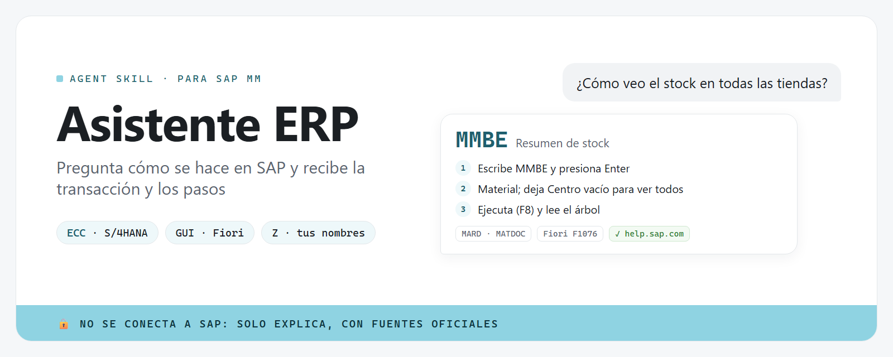

**Español** · [English](README.en.md)



<p align="center"><strong>Pregúntale a tu asistente de IA cómo hacer algo en SAP, en español sencillo, y recibe el código de transacción, los pasos y las tablas, adaptados a tu versión de SAP y a los nombres de tu empresa.</strong></p>

## ¿Qué es esto?

**Asistente ERP** es un "skill" (un paquete de conocimiento) para SAP MM que se instala en tu asistente de IA. Le preguntas, por ejemplo,
*"¿cómo veo el stock en todas las tiendas?"*, y te responde:

- **el código de transacción** (como `MMBE`), que es lo que escribes en SAP para llegar directo a la pantalla;
- **los pasos**, uno por uno, en palabras simples;
- **los campos y tablas** importantes, por si los necesitas;
- **las diferencias** entre SAP ECC y SAP S/4HANA, y la app Fiori equivalente.

La primera versión cubre **MM (gestión de materiales): inventario y compras**.

## ¿Para quién es?

Para quien usa SAP en el trabajo y no recuerda (o nunca aprendió) cómo se hace algo:
personal de almacén, compras, planificación, administración, o gente nueva en la empresa.
No necesitas saber programar.

> [!IMPORTANT]
> **No se conecta a SAP.** Solo explica. No entra a tu sistema, no ve tus datos y nunca te pide tu contraseña.
> **Todo sale de documentación oficial.** Cada respuesta viene de una ficha revisada contra [help.sap.com](https://help.sap.com), con su enlace. Lo que no se pudo confirmar dice "sin verificar".
> **Tu empresa puede tener SAP configurado distinto.** Si algo no coincide, pregúntale al usuario clave (key user) de SAP de tu empresa.

## Cómo usarlo (la forma más fácil)

1. **Pídele a tu asistente de IA que lo instale.** Si usas Claude Code u otro agente de IA
   (un asistente que puede trabajar con archivos en tu computadora), copia y pega este mensaje:

   ```text
   Instala el skill asistente-erp desde https://github.com/alejandrocimentada/asistente-erp
   ```

   <details>
   <summary><b>¿No tienes un agente de IA? Así empiezas (5 minutos)</b></summary>

   1. **Qué es un agente de IA:** un asistente, como Claude Code, que puede trabajar con archivos
      en tu computadora: leerlos, ejecutar programas y explicarte los resultados.
   2. **Abre la terminal** (la ventana donde se escriben comandos):
      - Windows: presiona la tecla Windows, escribe "PowerShell" y ábrelo.
      - Mac: presiona Cmd + Espacio, escribe "Terminal" y ábrela.
   3. **Instala Claude Code** siguiendo la
      [guía oficial de inicio rápido](https://code.claude.com/docs/es/quickstart) (pasos 1 y 2).
      Necesitarás una cuenta de Claude; la guía explica qué planes incluyen Claude Code.
   4. **Escribe `claude`** y presiona Enter para abrir el agente. La primera vez te pedirá
      iniciar sesión con tu cuenta de Claude. Luego pega el mensaje del paso 1.

   </details>

2. **Responde 4 preguntas la primera vez.** El asistente te preguntará:
   - **Tu versión de SAP.** Para verla: en SAP GUI, menú **Sistema → Status** (System → Status).
     Ahí aparece si es ECC (por ejemplo "EHP8") o S/4HANA (por ejemplo "S/4HANA 2023").
     Si no sabes, di "no sé" y sigue.
   - **Si usas SAP GUI** (la pantalla clásica, con un campo para escribir transacciones) **o Fiori** (las "fichas" en el navegador).
   - **El idioma de tu SAP** (español, inglés…).
   - **Si tu empresa tiene transacciones propias** (las que empiezan con Z, como `ZMM_STOCK`).

   Tus respuestas se guardan en tu computadora, en `~/.config/asistente-erp/profile.yaml`.

3. **Pregunta lo que necesites**, como se lo preguntarías a un compañero:

   > ¿Cómo creo una orden de compra?
   > ¿Cómo sé cuándo llega lo que pedimos?
   > ¿Cómo paso stock de un almacén a otro?
   > ¿Cómo bajo este reporte a Excel?

## Enséñale cómo se llaman las cosas en tu empresa

Muchas empresas tienen sus propias transacciones o nombres. Solo díselo al asistente:

> Aquí lo llamamos "consulta rápida", es la transacción ZMM_STOCK.

El asistente lo guarda y, la próxima vez, te responde primero con **tu** transacción y
después con la estándar de SAP.

## Ejemplo de respuesta

> **Pregunta:** ¿Cómo veo el stock en todas las tiendas?
>
> **`MMBE`**: muestra cuánto hay de un material en cada centro (tienda), almacén y lote.
> 1. Escribe `MMBE` en el campo de comandos y presiona Enter.
> 2. Escribe el código del material. Deja vacíos Centro y Almacén para ver todos.
> 3. Presiona Ejecutar (F8) y lee el árbol: la columna *Libre utilización* es lo disponible.
>
> En S/4HANA también puedes usar la app Fiori *Stock - Single Material* (F1076).
> Si no ves algunos centros, puede ser un tema de permisos: pregúntale a tu usuario clave.
> Fuente: help.sap.com

## ¿Qué cubre la versión 1?

| Tarea | Transacción |
|---|---|
| Ver el stock de un material en todos los centros y almacenes | `MMBE` |
| Lista de stock de un centro o almacén (muchos materiales) | `MB52` |
| Ver los movimientos de un material | `MB51` |
| Ver stock, necesidades y entradas futuras | `MD04` |
| Ver / modificar los datos de un material | `MM03` / `MM02` |
| Stock mínimo, punto de pedido y stock de seguridad | `MM02` (vistas MRP) |
| Crear / modificar / ver una orden de compra | `ME21N` / `ME22N` / `ME23N` |
| Órdenes de compra por proveedor / por material | `ME2L` / `ME2M` |
| Crear / ver una solicitud de pedido | `ME51N` / `ME53N` |
| Registrar la entrada de mercancía de una orden de compra | `MIGO` |
| Traspasar stock entre almacenes o centros | `MIGO` |
| Pedido de traslado entre centros | `ME21N` + `MIGO` |
| Exportar un reporte a Excel | (cualquier reporte) |

## Glosario

- **Transacción (código de transacción)**: el "atajo" que escribes en SAP para abrir una pantalla, como `MMBE` o `ME21N`.
- **Centro (Plant)**: una planta, tienda o sucursal. Es la unidad principal donde se lleva el stock.
- **Almacén (Storage Location)**: un lugar dentro del centro donde se guarda la mercancía.
- **Pedido / orden de compra**: el documento con el que se le compra a un proveedor. En SAP en español se llama "pedido".
- **Solicitud de pedido**: el aviso interno a Compras de que se necesita algo. Compras lo convierte en pedido.
- **Clase de movimiento**: código de 3 dígitos que dice qué tipo de movimiento de stock fue (por ejemplo 101 = entrada por pedido).
- **ECC y S/4HANA**: ECC es la versión anterior de SAP; S/4HANA es la nueva. Casi todas las transacciones siguen igual, pero algunas cosas cambian por dentro.
- **SAP GUI y Fiori**: SAP GUI es el programa clásico; Fiori es la interfaz web con fichas (apps).
- **Transacciones Z**: transacciones creadas por tu empresa. Empiezan con Z o Y y solo existen en tu sistema.
- **Usuario clave (key user)**: la persona de tu empresa que conoce cómo está configurado SAP en tu área.

## Preguntas frecuentes

**¿Puede ver mis datos de SAP o hacer cosas por mí en SAP?**
No. No se conecta a SAP. Solo te explica qué hacer; tú lo haces en tu SAP.

**¿Y si mi pantalla no se ve igual?**
Es normal: cada empresa configura SAP a su manera y los nombres cambian según el idioma y la
versión. El código de transacción es lo más confiable. Si algo no coincide, pregúntale a tu usuario clave.

**¿Y si pregunto algo que no está cubierto?**
El asistente te dirá que no lo tiene en su base de conocimiento, en lugar de inventar.
Por ahora cubre MM (inventario y compras); ventas, finanzas o producción todavía no.

**¿Dónde se guarda lo que le digo de mi empresa?**
En un archivo en tu propia computadora (`~/.config/asistente-erp/profile.yaml`), fuera de la
carpeta del skill. No se envía a ningún lugar.

**¿Necesito saber programar?**
No, si usas un agente de IA como Claude Code. El agente se encarga de todo.

---

## Para usuarios técnicos

**asistente-erp** es una skill de SAP MM para agentes de IA (Claude Code, Codex y otros agentes compatibles
con `SKILL.md`). Es solo conocimiento: [`SKILL.md`](SKILL.md) + fichas YAML en
[`knowledge/mm/`](knowledge/mm/) + dos scripts pequeños en Python. El agente busca la respuesta
con `scripts/erp_lookup.py` y contesta a partir de la ficha, no de memoria.

### Instalación manual

Requisitos: Python 3.10 o superior y `pip`.

**Claude Code (macOS / Linux)**

```bash
git clone https://github.com/alejandrocimentada/asistente-erp.git
mkdir -p ~/.claude/skills/asistente-erp
cp -R asistente-erp/. ~/.claude/skills/asistente-erp/
pip install -r ~/.claude/skills/asistente-erp/requirements.txt
```

**Claude Code (Windows PowerShell)**

```powershell
git clone https://github.com/alejandrocimentada/asistente-erp.git
New-Item -ItemType Directory -Force "$HOME\.claude\skills\asistente-erp" | Out-Null
Copy-Item -Recurse -Force "asistente-erp\*" "$HOME\.claude\skills\asistente-erp\"
pip install -r "$HOME\.claude\skills\asistente-erp\requirements.txt"
```

**Codex**

```bash
git clone https://github.com/alejandrocimentada/asistente-erp.git
mkdir -p ~/.codex/skills/asistente-erp
cp -R asistente-erp/. ~/.codex/skills/asistente-erp/
pip install -r ~/.codex/skills/asistente-erp/requirements.txt
```

### Uso como comando (sin agente)

```bash
python scripts/erp_lookup.py "ver stock en todas las tiendas"   # busca en español o inglés
python scripts/erp_lookup.py "create purchase order" --top 1
python scripts/erp_lookup.py --id goods-receipt-po              # una ficha completa
python scripts/erp_lookup.py --list                             # todas las fichas
python scripts/erp_lookup.py "MIGO" --json                      # salida en JSON
```

Si no encuentra nada, imprime `SIN RESULTADOS` y sale con código 1 (el agente no debe inventar).
Las preguntas claramente de otras áreas (ventas, finanzas, nómina, producción) se rechazan.

```bash
python scripts/erp_profile.py show                               # ver el perfil
python scripts/erp_profile.py set sap_product s4hana             # ecc | s4hana | s4hana_cloud | unknown
python scripts/erp_profile.py set ui fiori                       # gui | fiori | both
python scripts/erp_profile.py add-name --term "consulta rápida" --tcode ZMM_STOCK --entry stock-overview
python scripts/erp_profile.py remove-name --term "consulta rápida"
```

El perfil vive en `~/.config/asistente-erp/profile.yaml` (o en la ruta de la variable
`ASISTENTE_ERP_PROFILE`). El script se niega a guardarlo dentro de la carpeta del skill.

### Formato de las fichas

Una ficha por tarea en `knowledge/mm/<id>.yaml`:

| Campo | Contenido |
|---|---|
| `id`, `names.es`, `names.en` | identificador y nombre de la tarea en español e inglés |
| `tcode`, `related_tcodes` | transacción principal y relacionadas |
| `keywords.es`, `keywords.en` | cómo lo pregunta la gente (para la búsqueda) |
| `summary` | qué hace, en una o dos frases |
| `s4hana_notes` | diferencias entre ECC y S/4HANA |
| `fiori_app` | nombre e ID de la app Fiori (o `null` si no hay una verificada) |
| `steps` | pasos en español sencillo |
| `key_fields` | campos clave, con su nombre técnico cuando está verificado |
| `tables` | tablas principales (MARA, MARC, MARD, EKKO, EKPO, MSEG/MATDOC…) |
| `common_errors` | errores comunes, qué significan y qué hacer; `verified: true/false` |
| `verification` | `status` (`verificado` / `parcial`) y la lista `sin_verificar` |
| `sources`, `last_verified` | enlaces a help.sap.com y fecha de la última revisión |

### ¿Hasta qué punto está verificado?

Revisado el **2026-10-08** contra la documentación oficial de SAP en
[help.sap.com](https://help.sap.com) (SAP Help Portal y SAP Support Content), con 59 páginas
distintas citadas. Los textos son propios: explican con otras palabras, no copian la documentación.

- **18 fichas.** **15 "verificado"**: la transacción, las diferencias ECC / S/4HANA, la app
  Fiori y las tablas están respaldadas por una fuente. 13 de esas 15 tienen además algún
  detalle menor anotado en `sin_verificar` (por ejemplo, el nombre exacto de una casilla o
  un campo técnico). **3 "parcial"**:
  - `ME2L` y `ME2M`: solo se encontró documentación de ECC; que sigan en S/4HANA no está confirmado
    (se ofrece la app Fiori *Monitor Purchase Order Items*, F2358, que sí lo está).
  - Pedido de traslado: no se encontró una app Fiori específica, y el flujo con entrega
    (`VL10B` / `VL02N`) depende de la configuración de cada empresa.
- **Errores comunes:** 11 de 39 están respaldados por una fuente (por ejemplo `M7021` y `ME083`);
  el resto son situaciones típicas y la ficha los marca `verified: false`.
- **Los pasos** describen el SAP estándar. Las etiquetas de pantalla en español no se pudieron
  confirmar una por una: por eso cada paso lleva el nombre en inglés entre paréntesis.
- **Los enlaces se comprueban** con `python scripts/check_sources.py` (59 de 59 funcionaban el 2026-10-08).

### Desarrollo y validación

```bash
pip install -r requirements.txt pytest
python -m pytest                       # 152 pruebas
python scripts/check_sources.py        # comprueba los enlaces (necesita internet)
```

Las pruebas revisan que cada ficha tenga todos los campos y al menos una fuente de help.sap.com,
que la búsqueda encuentre la ficha correcta para 32 preguntas típicas en español e inglés (y
ninguna para preguntas fuera de alcance), y que el perfil se guarde y lea bien sin escribir
nunca dentro de la carpeta del skill. El banner se genera desde [`docs/banner.html`](docs/banner.html).

### Agregar o corregir una ficha

1. Copia una ficha parecida en `knowledge/mm/` y cambia `id` (igual al nombre del archivo).
2. Verifica cada dato en help.sap.com y agrega el enlace en `sources`. Lo que no puedas
   confirmar va en `verification.sin_verificar`; si es la transacción, la diferencia con
   S/4HANA, la app Fiori o una tabla, el `status` es `parcial`.
3. Escribe con tus propias palabras. No copies texto de la documentación de SAP.
4. Actualiza `last_verified` y corre `python -m pytest` y `python scripts/check_sources.py`.

### Límites conocidos

- **No se conecta a SAP**: no puede ver tu configuración, tus permisos ni tus transacciones Z;
  solo sabe de ellas lo que tú le cuentes.
- **Solo MM (inventario y compras)** en esta versión. Ventas (SD), finanzas (FI/CO), producción
  (PP) y mantenimiento (PM) no están cubiertos.
- **SAP estándar**: cada empresa configura clases de pedido, aprobaciones, clases de movimiento
  y campos obligatorios a su manera.
- **La búsqueda es por palabras clave**, no entiende cualquier frase. Si no encuentra algo que sí
  está cubierto, el agente puede usar `--list` o `--id`.
- **SAP cambia**: S/4HANA Cloud se actualiza varias veces al año. Revisa `last_verified` en cada ficha.

## Aviso

Proyecto independiente, sin relación con SAP SE. SAP, SAP S/4HANA, SAP Fiori y SAP ERP son
marcas registradas de SAP SE. Los enlaces apuntan a la documentación pública de SAP.

## Licencia

[MIT](LICENSE) © 2026 Alejandro Cimentada.
